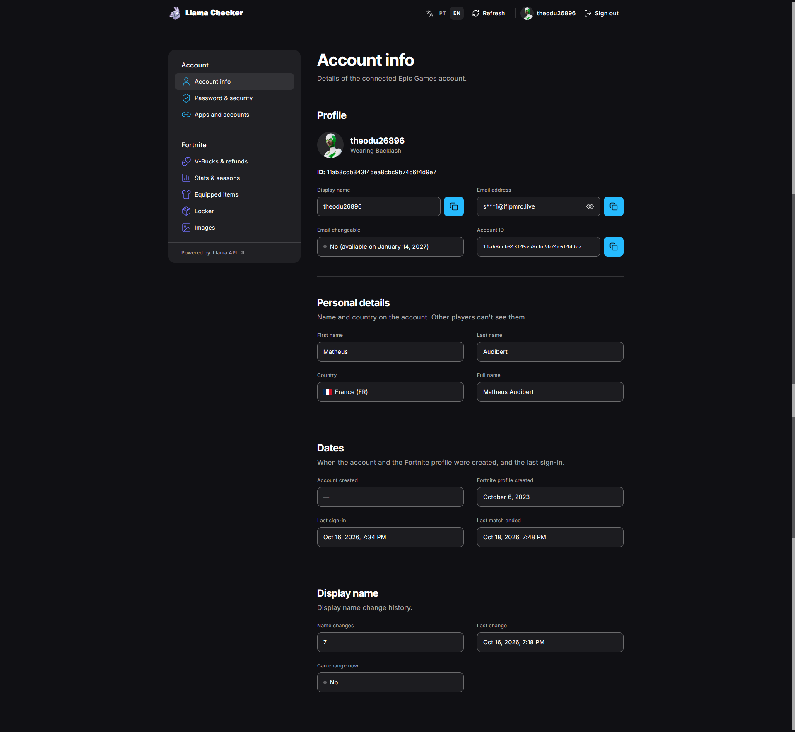
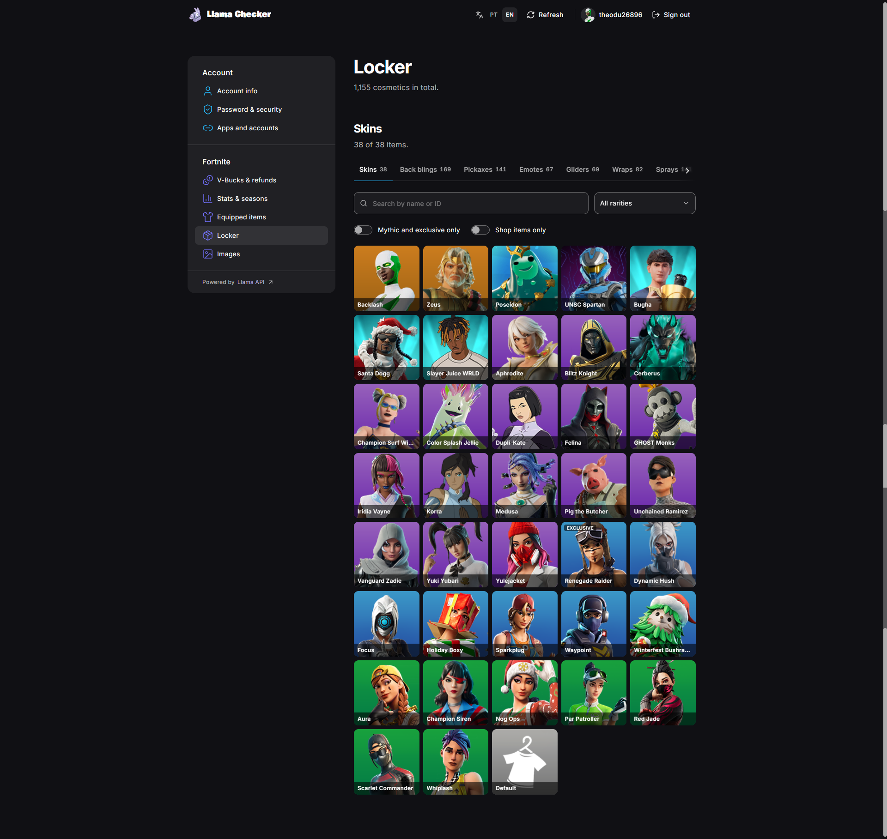
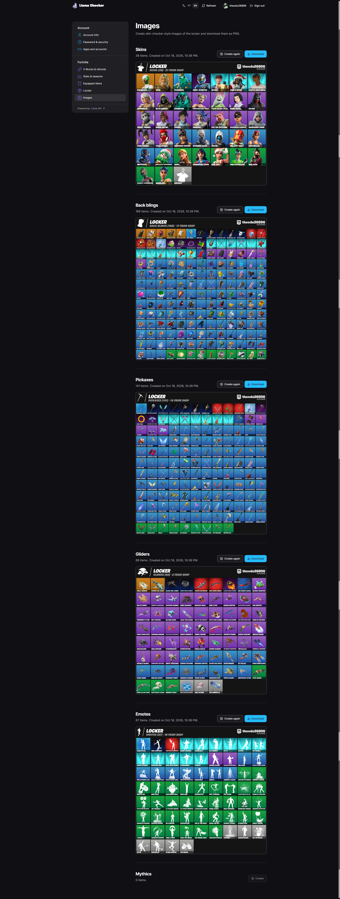

<div align="center">

<a href="https://llamachecker.audibert.dev/"></a>

[](https://github.com/matheusaudibert/llama-checker/stargazers)
[](https://llamachecker.audibert.dev/)
[](https://twitter.com/audibertdev)
[](https://discord.com/users/161092845040566272)

</div>

A Fortnite account checker built on the [Llama API](https://llamaapi.mintlify.site/guides/introduction). Try it at **[llamachecker.audibert.dev](https://llamachecker.audibert.dev/)**.

You sign in with your Epic Games account on an official Epic page, so your password never touches this site, and get the full picture of the account: profile, security, linked platforms, V-Bucks, stats and every item in the locker. The layout follows the Epic Games account settings pages.

## Screenshots

<table>
  <tr>
    <td width="50%"></td>
    <td width="50%"></td>
  </tr>
  <tr>
    <td align="center">Account info</td>
    <td align="center">Locker</td>
  </tr>
</table>

<details>
<summary>Skin checker images of the locker</summary>
<br>

</details>

## Features

**Account**

- Sign in with Epic Games through the device code flow: approve on Epic's site, no password typed here
- Profile, personal details and account dates, with the email masked until you reveal it
- Whether the display name and the email can be changed, and when a locked email unlocks
- Two-factor authentication, email verification and parental controls
- Linked consoles (PlayStation, Xbox, Nintendo) and other accounts (Steam, GitHub, Twitch…), plus the platforms still free to link

**Fortnite**

- V-Bucks per platform and refund tickets
- Account level, wins and the history of every past season
- Current loadout: outfit, back bling, pickaxe, emotes, wraps and more
- The full locker, with search in English and Portuguese, a rarity filter and switches for mythic/exclusive and shop items
- Item details with rarity, series, unlocked styles and the shop price in V-Bucks
- Skin checker style images of the locker, generated per category and ready to download

**Site**

- Portuguese and English
- The last fetched data is saved in the browser and stays visible even after the Epic session expires
- Right-click the logo for links to the Llama API docs and this repository, or to download the logo

## How it works

The Llama API needs an API key and has no CORS, so the browser never calls it directly. Every request goes to `/api/*` on the same site, and a small proxy adds the key on the server:

- **Production:** [`api/proxy.ts`](api/proxy.ts), a Vercel function. [`vercel.json`](vercel.json) rewrites `/api/<route>` to it and sends every other path to the single-page app.
- **Development:** the Vite dev server proxies `/api` the same way ([`vite.config.ts`](vite.config.ts)).

The key is read without the `VITE_` prefix, so it never ends up in the JavaScript bundle.

## Running locally

Requirements: Node.js 20.19 or newer and a Llama API key.

```bash
git clone https://github.com/matheusaudibert/llama-checker.git
cd llama-checker
npm install
cp .env.example .env   # then set LLAMA_API_KEY
npm run dev
```

| Script | What it does |
| --- | --- |
| `npm run dev` | Starts the dev server with the API proxy |
| `npm run build` | Type-checks and builds to `dist/` |
| `npm run preview` | Serves the build, also with the API proxy |
| `npm run lint` | Runs ESLint |
| `npm run gen:types` | Regenerates [`src/lib/llama-api.d.ts`](src/lib/llama-api.d.ts) from the Llama API OpenAPI schema |

## Deploying

The project is ready for [Vercel](https://vercel.com/): import the repository, keep the Vite preset and add the `LLAMA_API_KEY` environment variable. The proxy function and the rewrites come from the repository.

## Built with

React 19, TypeScript, Vite and Tailwind CSS 4, with [Motion](https://motion.dev/) for animations, [Lucide](https://lucide.dev/) icons and brand icons from [Simple Icons](https://simpleicons.org/).

## License

[MIT](LICENSE). Fortnite and Epic Games are trademarks of Epic Games, Inc. This project is not affiliated with or endorsed by Epic Games.
